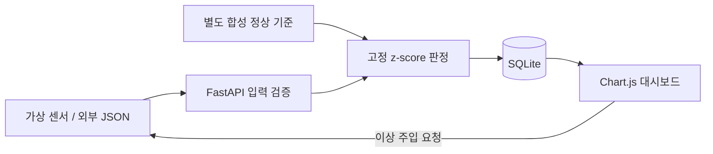

# AIFLab SensorScope 사용 안내

[프로젝트 소개](../README.md)

**산업 설비 센서 데이터 기반 실시간 이상 징후 탐지 및 모니터링 시스템**

A lightweight industrial sensor anomaly monitoring demo.

[](https://github.com/jhlimdev/aiflab-sensorscope/actions/workflows/ci.yml)


프레스·모터·펌프의 가상 센서 데이터를 생성하고, 고정된 통계적 기준과 비교해 이상
징후를 표시하는 작은 오픈소스 프로젝트입니다. Python 서버 하나로 대시보드, API,
시뮬레이터, SQLite 저장소를 실행합니다. GPU나 외부 데이터 서비스는 필요하지 않습니다.

> **연구·교육용 MVP입니다.** 데이터와 기준값은 모두 합성한 데모 값입니다.
> 실제 산업 설비에서 검증한 정확도, 고장 예측, 안전 제어, 디지털 트윈 기능을 주장하지 않습니다.


## 주요 기능

- 3개 가상 설비에서 온도(°C)·진동(mm/s)·전류(A)를 기본 1초 간격으로 생성
- 설비·센서별 고정 평균/표준편차와 절대 z-score를 이용한 이상 판정
- Chart.js 대시보드: 설비 선택, 센서 전환, 통계적 기준 범위, 이상 지점 표시
- 선택한 센서의 값을 8회 높이는 이상 주입 버튼
- SQLite 측정값·이상 이벤트 저장 및 재시작 후 복원
- 외부 JSON 입력 API, CSV 재생 예제, OpenAPI 문서
- 모바일 레이아웃, 연결 실패·복구 표시, 데이터 미수신 상태 표시
- 자동 테스트, Docker Compose, GitHub Actions

## 빠른 실행 — Docker

Docker Desktop 또는 Docker Engine + Compose v2가 필요합니다.

```bash
git clone https://github.com/jhlimdev/aiflab-sensorscope.git
cd aiflab-sensorscope
docker compose up --build -d --wait
```

- 대시보드: <http://127.0.0.1:8000>
- API 문서: <http://127.0.0.1:8000/docs>
- 상태 확인: <http://127.0.0.1:8000/api/health>

대시보드에서 설비와 센서를 선택하고 **이상 주입**을 누르면 다음 8개 측정값에
양의 변화가 추가됩니다. 기본 설정에서는 약 8초간 지속되며, 그래프와 이벤트 표에서
변화를 확인할 수 있습니다. 이상 주입 전에도 정규분포 꼬리의 값이 통계적으로 탐지될 수 있습니다.

```bash
docker compose logs -f
docker compose down
```

`down` 후에도 이름 있는 볼륨에 데이터가 유지됩니다. **모든 데모 기록을 삭제**하려면
`docker compose down -v`를 실행합니다. 8000번 포트가 사용 중이면 macOS/Linux에서
`SS_PORT=8001 docker compose up --build -d --wait`를 실행하세요. Windows에서는
`.env.example`을 `.env`로 복사하고 `SS_PORT=8001`로 바꿀 수 있습니다.

## Python 직접 실행

Python **3.12 이상**을 사용하세요. 첫 설치에는 인터넷 연결이 필요합니다.

```bash
python3 -m venv .venv
source .venv/bin/activate
python -m pip install -r requirements.txt
python -m uvicorn sensorscope.main:app --host 127.0.0.1 --port 8000
```

Windows PowerShell에서는 `py -3.12 -m venv .venv` 후
`.\.venv\Scripts\Activate.ps1`로 활성화합니다. 종료는 `Ctrl+C`입니다.
기본 데이터베이스는 `data/sensorscope.sqlite3`이며 Git에는 포함되지 않습니다.
실행 시 **worker는 1개**를 사용하세요. 각 프로세스가 자체 시뮬레이터를 실행합니다.

Chart.js를 저장소에 포함하므로 대시보드는 실행 중 CDN이 필요하지 않습니다.
FastAPI의 `/docs` 화면은 기본 Swagger UI CDN을 사용해 인터넷이 필요할 수 있습니다.
오프라인에서는 `/openapi.json`으로 API 명세를 확인할 수 있습니다.

## 탐지 원리와 데모 가정

각 설비의 각 센서마다 독립된 정상 기준 데이터 240개를 생성하여 표본 평균 `μ`와
표본 표준편차 `s`를 계산합니다. 기준 생성 seed는 `1729`, 실시간 시뮬레이터 기본
seed는 `2026`으로 **기준 데이터와 실행 데이터는 분리**됩니다.

```text
z = abs(x - μ) / max(s, 최소 표준편차)
하나 이상의 센서에서 z >= SS_THRESHOLD 이면 해당 측정값을 이상으로 기록
기본 SS_THRESHOLD = 3.5
```

기준은 실행 데이터로 갱신하지 않습니다. 연속 이상값이 정상 기준에 흡수되는 것을
방지하지만, 실제 공정의 드리프트나 운전 모드 변화에는 적응하지 못합니다.
최소 표준편차는 온도 `0.1`, 진동 `0.01`, 전류 `0.05`입니다.

| 설비 | 온도 평균 ± σ (°C) | 진동 평균 ± σ (mm/s) | 전류 평균 ± σ (A) |
|---|---:|---:|---:|
| press-01 | 55 ± 1.2 | 0.45 ± 0.04 | 12 ± 0.35 |
| motor-02 | 42 ± 0.9 | 0.30 ± 0.03 | 8 ± 0.25 |
| pump-03 | 38 ± 0.8 | 0.22 ± 0.02 | 5.5 ± 0.20 |

위 값은 **데이터 생성용 가정**이며, 실제 판정 기준은 이 분포에서 생성한 기준
데이터로 추정합니다. 진동은 속도 RMS와 같은 요약값을 모사한 임의 스칼라로,
주파수·센서 특성·설비 물리법칙을 모델링하지 않습니다. 이상 주입은 해당 센서에
생성 표준편차의 `8배`를 더합니다. 난수 seed가 같으면 값의 순서는 재현되지만
실행 시각, 사용자 주입 시점, 서버 지연에 따라 타임스탬프와 이벤트 순서는 달라집니다.

센서 간 상관관계, 다중 검정 보정, 고장 원인 분석, 학습된 예지보전 모델은 없습니다.
합성 데이터의 정상/이상 시연을 실제 성능 평가로 해석해서는 안 됩니다.

## 외부 데이터 입력 및 예제

시뮬레이터와 외부 입력을 섞지 않도록 기본 데모 모드에서는 외부 POST를 거부합니다.
Python 실행 시 아래처럼 별도의 DB를 사용하세요.

```bash
SS_SIMULATOR=false SS_DB_PATH=data/external.sqlite3 \
  python -m uvicorn sensorscope.main:app --host 127.0.0.1 --port 8000
```

PowerShell에서는 `$env:SS_SIMULATOR="false"; $env:SS_DB_PATH="data/external.sqlite3"`를
설정한 뒤 서버를 실행합니다. Docker에서는 `.env`의 `SS_SIMULATOR=false` 설정 후
`docker compose up -d`로 컨테이너를 재생성합니다.

별도 터미널에서 다음을 실행합니다.

```bash
curl -X POST http://127.0.0.1:8000/api/readings \
  -H 'Content-Type: application/json' --data-binary @examples/reading.json
python scripts/replay_csv.py examples/readings.csv --interval 1
```

`reading.json`은 `press-01`의 진동 이상 예제입니다. CSV에는 정상 3개와 이상 3개가
있습니다. `timestamp`를 생략하면 서버 수신 시각을 사용합니다. 지정한다면
`2026-10-15T07:00:00+00:00`처럼 시간대를 포함해야 합니다. 설비별 마지막 측정값보다
이전 또는 같은 시각은 `409`, 현재보다 5초를 초과하는 미래 시각은 `422`입니다.
NaN/Infinity, 누락·추가 필드, 미등록 설비, 범위를 벗어난 수치도 거부합니다.

입력 허용 범위는 온도 `-50~250`, 진동 `0~100`, 전류 `0~500`이며, 파서의
방어적 범위일 뿐 안전 임곗값이 아닙니다. 외부 모드도 **합성 데모 기준**을 그대로
사용합니다. 실제 설비 적용에는 별도의 정상 기준 수집·교정·검증이 필요합니다.

## API

| 메서드 | 경로 | 내용 |
|---|---|---|
| GET | `/api/health` | 상태 및 시뮬레이터 동작 모드 |
| GET | `/api/overview` | 설비 상태, 기준값, 저장 건수, 설정 |
| GET | `/api/readings/{machine_id}?limit=60` | 오래된 순서의 최근 측정값 |
| POST | `/api/readings` | 외부 모드에서 측정값 1개 수신 |
| GET | `/api/events?limit=100&machine_id=press-01` | 최신순 이상 이벤트, 설비 필터 선택 |
| POST | `/api/demo/anomaly` | `{"machine_id":"press-01","metric":"vibration"}` |

조회 `limit`은 1~300입니다. 설비 ID는 `press-01`, `motor-02`, `pump-03`, 센서는
`temperature`, `vibration`, `current`입니다. 중복 이상 주입 요청은 진행 중인 8회가
끝날 때까지 `409`를 반환합니다. 대시보드는 1초마다 HTTP로 갱신합니다.

## 저장 정책과 설정

- 측정값은 **설비별 최근 3,000개**, 이벤트는 **전체 최근 1,000개**만 유지합니다.
- 이벤트는 이상 **측정값 1개당 1건**이며, 연속 이벤트를 하나의 사고로 묶지 않습니다.
- 화면의 건수는 저장 중인 기록 수이며, 누적 고장 횟수나 전체 처리 건수가 아닙니다.
- 최신 수신 시각이 `max(5초, 생성 간격 × 3)`보다 오래되면 수신 대기로 표시합니다.
- 서버 재시작 시 기존 기록은 유지되며, 시뮬레이터 난수 순서는 처음부터 시작합니다.
- 설정을 바꾸어도 과거 이벤트의 점수와 임곗값은 보존됩니다. 차트의 기준선은 **현재 설정**입니다.

| 환경 변수 | 기본값 | 설명 |
|---|---|---|
| `SS_SIMULATOR` | `true` | `true` 또는 `false` |
| `SS_INTERVAL` | `1` | 센서 생성 간격, 0.1~60초 |
| `SS_THRESHOLD` | `3.5` | 절대 z-score 임곗값, 1~10 |
| `SS_SEED` | `2026` | 실행 데이터 난수 seed |
| `SS_DB_PATH` | `data/sensorscope.sqlite3` | Python 실행 DB 경로 |
| `SS_PORT` | `8000` | Docker Compose의 호스트 포트 |

Compose는 `.env`를 읽습니다. Python 직접 실행은 환경 변수를 읽으며 `.env`를
자동으로 불러오지 않습니다. Docker의 DB 경로는 `/app/data/sensorscope.sqlite3`로 고정됩니다.

이 MVP에는 인증·권한 관리가 없으므로 기본값인 로컬 루프백 주소에서 실행하세요.
인터넷 공개 서비스로 운영하려면 인증, TLS, 요청 제한, 백업, 동시성 설계를 추가해야 합니다.

## 테스트

```bash
python -m pip install -r requirements-dev.txt
pytest -q
ruff check .
ruff format --check .
```

테스트는 임시 DB를 사용합니다. 별도의 실행 서버에서 브라우저 검증을 하려면:

```bash
python -m pip install -r requirements-browser.txt
python -m playwright install chromium
python scripts/browser_smoke.py --url http://127.0.0.1:8000
```

브라우저 테스트는 실제 이상 주입을 실행해 이벤트를 남기며, `browser-artifacts/`에
데스크톱·모바일 스크린샷을 저장합니다. 기본 시뮬레이터 모드에서 실행하세요.
검증 환경과 결과는 [검증 기록](VERIFICATION.md)에 정리합니다.

## 구조

```text
sensorscope/
  config.py       데모 설비·단위·설정
  detector.py     기준 생성과 고정 z-score 판정
  models.py       입력 검증
  simulator.py    가상 센서 및 이상 주입
  storage.py      SQLite 저장·조회·보관 제한
  main.py         FastAPI API 및 수명주기
  static/         한국어 대시보드, Chart.js 배포본
examples/         JSON 입력, CSV 데이터
scripts/          CSV 재생, 브라우저 검증
tests/            탐지·입력·저장·시뮬레이터 통합 테스트
```



## 기여 및 라이선스

작은 버그 수정, 테스트, 재현 가능한 예제 기여를 환영합니다.
[기여 안내](../CONTRIBUTING.md)를 참고하세요. 이 프로젝트는 [MIT License](../LICENSE)로
배포하며, Chart.js 라이선스는 [별도 고지](../THIRD_PARTY_NOTICES.md)에 포함합니다.

구현 참고: [FastAPI lifespan](https://fastapi.tiangolo.com/advanced/events/),
[Chart.js documentation](https://www.chartjs.org/docs/latest/).
