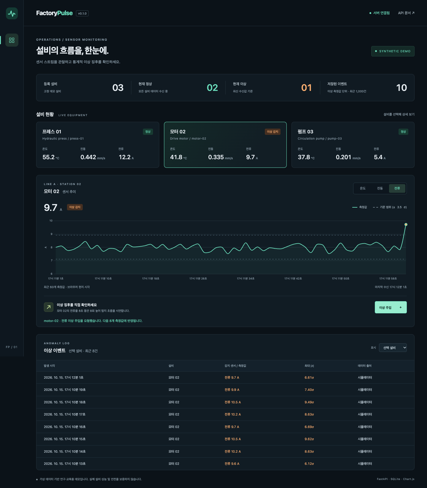

# 실행 및 검증 기록

검증일: **2026-10-15 (Asia/Seoul)**

| 항목 | 환경 / 확인 내용 | 결과 |
|---|---|---|
| 자동 테스트 | Python 3.12.14, `pytest -q` | **33 passed** |
| 정적 검사 | `ruff check .`, `ruff format --check .` | 통과 |
| JavaScript 구문 | `node --check sensorscope/static/app.js` | 통과 |
| Python 의존성 | `pip check` | 충돌 없음 |
| Python 직접 실행 | macOS ARM64, Uvicorn, `/api/health` | 정상 응답 |
| Docker 실행 | Docker 29.8.1, Compose, `python:3.12-slim` | 이미지 빌드 및 healthy 확인 |
| Docker 영속성 | 실제 이벤트 생성 후 컨테이너 재시작 | 기존 이벤트 ID 및 내용 유지 |
| 외부 입력 | 별도 서버에 CSV 6행 + JSON 예제 전송 | CSV 정상 3건·이상 3건, JSON 이상 1건 |
| 브라우저 | Playwright 1.64.0 + 설치된 Google Chrome | 기능 시나리오 통과, 페이지 오류 없음 |
| 모바일 | 390px 너비 별도 브라우저 세션 | 문서 가로 넘침 없음, 표 내부 가로 스크롤 |

브라우저에서 확인한 기능:

- 설비 카드 3개 및 서버 연결 상태
- 모터 선택, 전류 센서 전환, Chart.js 실제 데이터 렌더링
- 이상 주입 요청 → 이상 상태 표시 → SQLite 기반 이벤트 표 표시
- 선택 설비 이벤트 필터
- API 연결 차단 시 오류 표시와 주입 버튼 비활성화
- 연결 복구 시 자동 갱신 재개

실행 명령과 재현 절차는 [한국어 사용 안내](USER_GUIDE.ko.md)의 테스트 절을 참고하세요.
설치된 Chrome으로 검증할 때에는 `scripts/browser_smoke.py --browser-channel chrome`을 사용했습니다.

[실제 모바일 화면](images/dashboard-mobile.png)

## 해석 범위

위 검증은 소프트웨어 기능의 동작 확인입니다. 실제 설비 데이터에 대한 정확도,
재현율, 처리 성능, 안전성 평가가 아닙니다. 합성 기준과 합성 입력을 사용했습니다.
실제 테스트에서 Starlette가 `httpx` 테스트 클라이언트에 대해 `httpx2` 전환 예정
경고를 1건 출력했습니다. 테스트 실패나 서버 실행 오류는 아니며 경고를 숨기지 않았습니다.

GitHub Actions는 Linux의 Python 3.12/3.13 테스트 및 Docker 시작 검증을 실행하도록
설정되어 있습니다. 원격 실행 상태는 저장소의 Actions 탭에서 확인할 수 있습니다.
